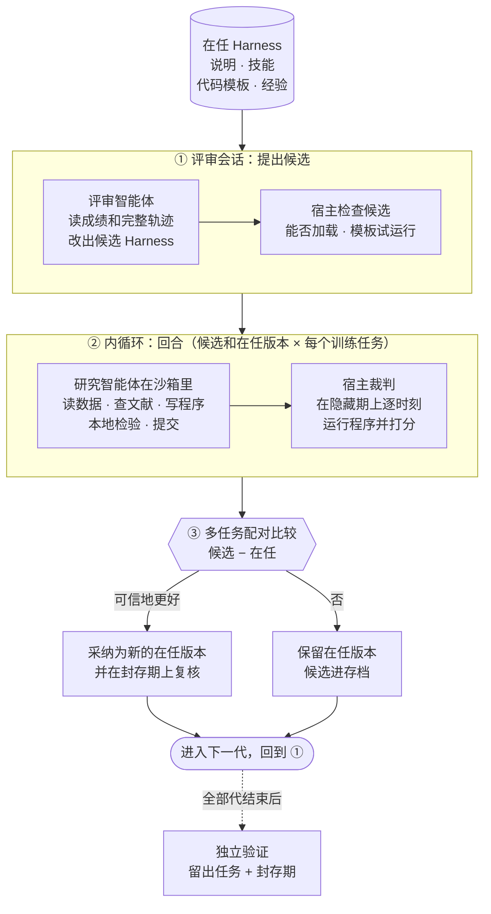
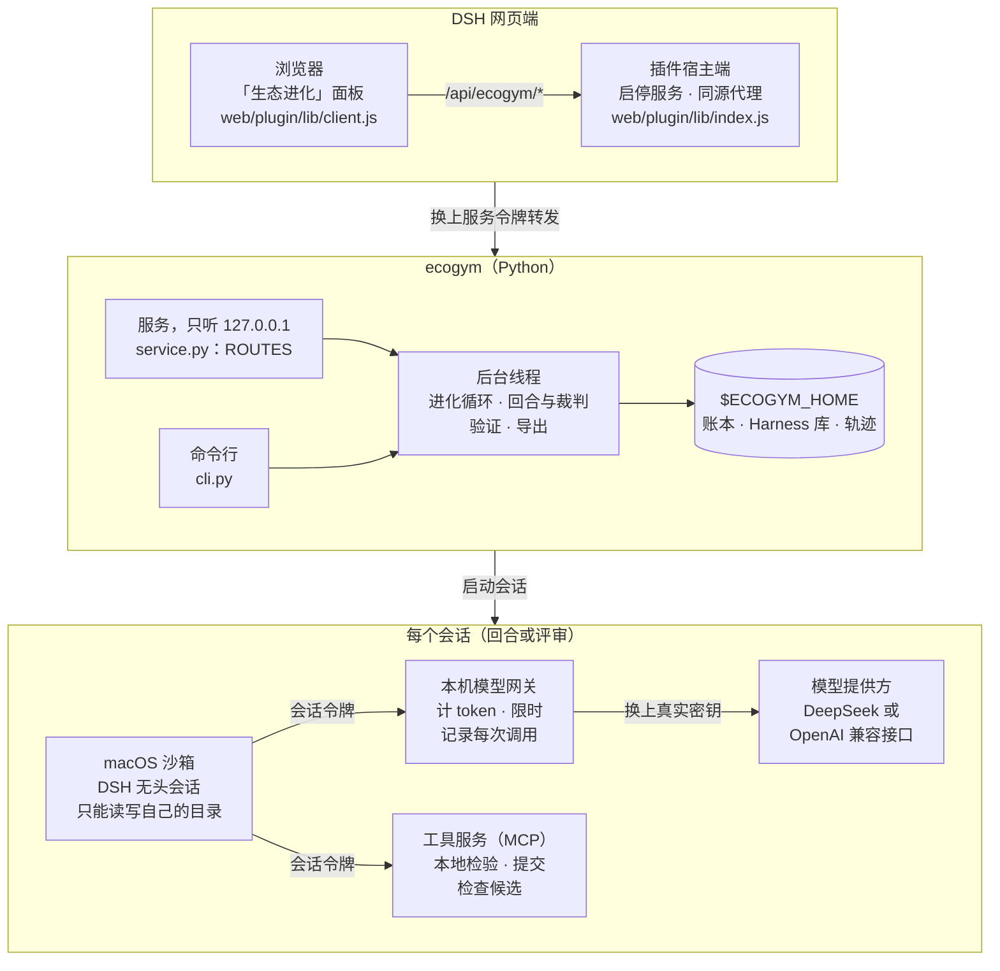
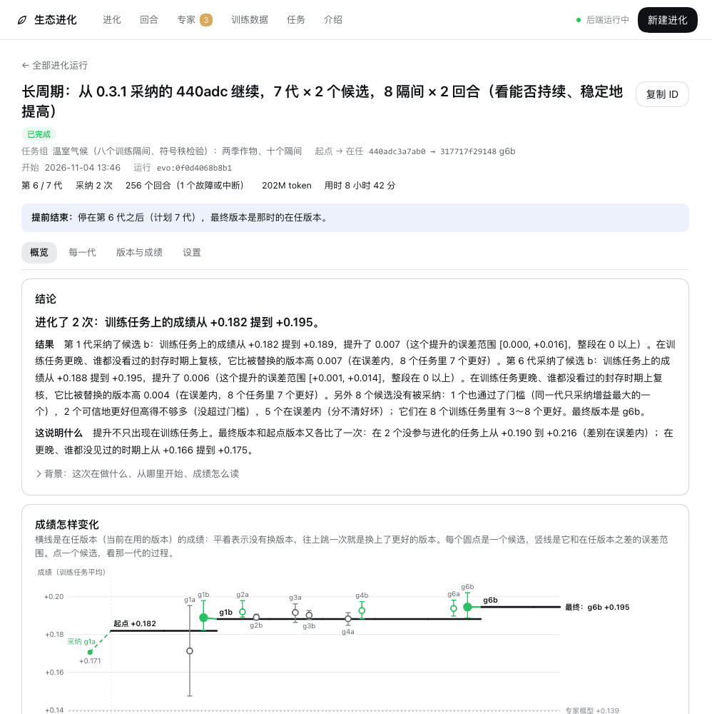
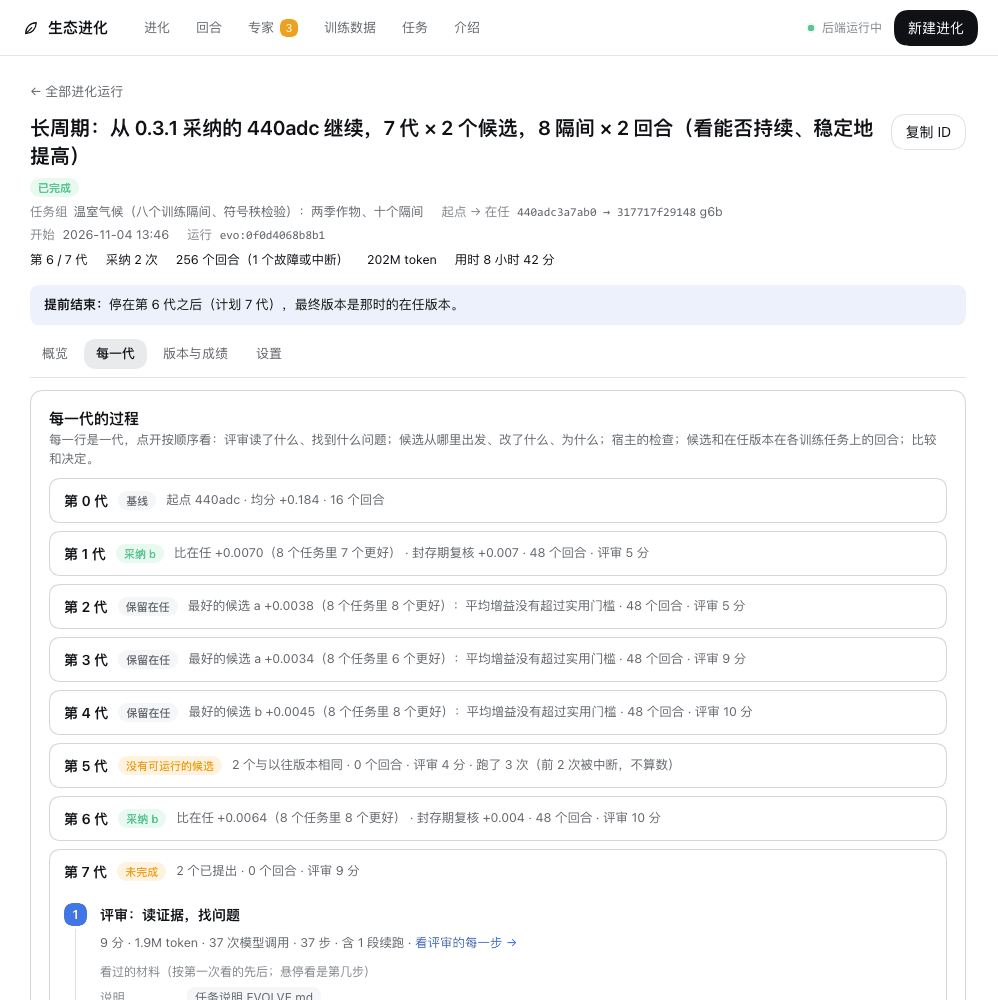

# EcologyRSI-DSH · ecogym

**让大模型研究智能体在生态预测任务上自己做研究，并在严格的统计检验下，一代代改进它的工作方式。**


ecogym 是一个训练场。给它一组生态预测任务，例如“根据温室过去的气候和控制记录，预报未来 1、6、24 小时的室内气温、湿度和 CO₂”，它会这样工作：

1. **研究智能体解题**：一个 DeepSeek Harness（DSH）智能体在沙箱里读可见数据、查文献、写预测程序、做本地检验，最后提交程序。
2. **宿主打分**：宿主在智能体看不到的时期（隐藏期）上逐时刻运行这个程序，按相对朴素预报的技能打分。打分由确定性代码完成，不交给大模型。
3. **评审智能体改进工作方式**：另一个智能体读完所有成绩和完整过程，改写研究智能体带进任务的 **Harness**，也就是它的工作说明、技能、代码模板和经验，提出候选版本。
4. **只采纳可信的提升**：候选和在任版本（当前采用的版本）在多个训练任务上各跑几次，做配对比较。只有可信地更好、而且好得足够多，才换上。
5. **独立验证**：最终版本还要在进化中没见过的任务，和更晚的、谁都没看过的时期（封存期）上各验证一次。

过程中积累两类资产：一版更好的 Harness，以及全部回合的完整轨迹（可以导出成多轮 SFT 数据和偏好对）。DSH 本身不改。ecogym 是 DSH 的插件，在侧栏的「生态进化」面板里就能发起和查看进化。

## 特点

- **进化的对象是 Harness，模型权重不动**：Harness 是普通文件（Markdown 说明、技能、Python 模板），按内容摘要存档。每一版都能比较差异、能回溯。
- **防止自欺**：智能体只看到隐藏期之前的数据，比较版本只用隐藏期的成绩。留出任务和封存期在进化中谁都看不到，每个版本在每个封存时期上只评一次。
- **有统计门槛的采纳**：多任务配对比较，用符号秩检验或 t 区间，加上实用门槛和单任务否决；一代有多个候选时按 Bonferroni 调整。每次采纳后，宿主还在封存期上复核一次。
- **隔离的执行环境**：智能体和它写的程序在 macOS 沙箱里运行，只能读写自己的目录。模型调用经本机网关转发，真实密钥不进沙箱，每次调用都有记录。
- **可中断、可追溯**：所有事件写进只追加、带哈希链的账本，界面上的每个数字都从账本算出。运行可以停下再继续；模型服务出故障时，运行自动等待，恢复后接着跑。
- **看得见的过程**：面板里能看到每一代评审读了什么、改了什么、为什么改，候选的每个回合和比较的结果。
- **领域可替换**：框架代码里不出现任何领域名称。自带温室领域，新领域按[接入指南](docs/new-domain.md)添加。

## 结果

数据是 Autonomous Greenhouse Challenge 的温室数据（2018 年黄瓜、2019 年番茄，共 10 个隔间）。从自带的起点 Harness 出发，连续做了 4 次进化运行，共 800 多个回合，每次都从上一次的最终版本接着进化。成绩是“3 个目标 × 3 个时距”的平均技能：0 表示和朴素预报一样，+0.2 大约是误差比朴素预报低 20%。表中箭头两边是起点版本和最终版本的成绩；封存 validation 在全部 10 个隔间上评，方括号里是增益的 95% 区间。

| 运行 | 代数 | 训练隔间 | 每次采纳的隐藏期增益 | 留出隔间 | 封存 validation |
|---|---|---|---|---|---|
| 1 | 2 | 4 | +0.075 | 6 个：0.109 → 0.171 | 0.093 → **0.150**<br>+0.057 [+0.028, +0.086] |
| 2 | 2 | 8 | +0.014 | 2 个：0.170 → 0.190 | 0.150 → **0.166**<br>+0.016 [+0.005, +0.027] |
| 3 | 7 | 8 | +0.007、+0.006 | 2 个：0.190 → 0.216 | 0.166 → **0.175**<br>+0.009 [+0.0003, +0.018] |
| 4 | 9 | 8 | +0.010、+0.011、+0.005 | 还没做 | 还没做 |

- 在进化中谁都没看过的封存期上，前三次运行把成绩从 0.093 提到 0.175，每一步的区间都在 0 以上。只有 2 个留出隔间时，留出任务上的区间都跨 0。
- 第 4 次运行停在第 10 代，还没有做最终验证。它的三次采纳各在训练隔间的封存期上复核过：+0.011、+0.014、+0.004，区间都在 0 以上。三次合计 +0.028，和采纳时在隐藏期上看到的 +0.026 相当，可见这些提升主要不是从隐藏期的随机波动里挑出来的。
- 作为参照：宿主内置的人工专家模型（只用拟合期的数据）在 8 个训练隔间的隐藏期上是 +0.140；第 4 次运行第 9 代采纳的版本在同样的隔间上是 +0.218。
- 研究智能体和评审智能体都用 DeepSeek V4.1 Flash，每个回合 8 分钟。过程和分析见 [docs/evolution.md](docs/evolution.md) 第 14、19 至 22 节。

## 目录

- [快速开始](#快速开始)
- [核心概念](#核心概念)
- [工作原理](#工作原理)：两层循环、一个回合、一代、数据切分、打分与采纳门槛、独立验证
- [系统架构](#系统架构)：运行时组成、代码分层、状态与恢复
- [使用](#使用)：DSH 面板、命令行、服务接口、长时间运行
- [配置](#配置)
- [训练数据](#训练数据)
- [方法竞技](#方法竞技)
- [扩展到新领域](#扩展到新领域)
- [已知限制](#已知限制)
- [文档](#文档)
- [开发](#开发)

## 快速开始

### 准备

| 需要 | 说明 |
|---|---|
| macOS | 智能体和被评分的程序在 `sandbox-exec` 沙箱里运行 |
| Python 3.11+ | 运行 ecogym 本身 |
| DeepSeek Harness（`dsh`） | 已在 0.1.5-rc.2 上验证；智能体的会话都是 DSH 的无头会话 |
| 一个模型提供方 | DeepSeek 官方接口（`DEEPSEEK_API_KEY`），或 DSH 设置里任一 `openai-completions` 类型的提供方 |
| 数据 | Autonomous Greenhouse Challenge 的 [2018 黄瓜](https://doi.org/10.4121/uuid:e4987a7b-04dd-4c89-9b18-883aad30ba9a)和 [2019 番茄](https://doi.org/10.4121/uuid:88d22c60-21b3-4ea8-90db-20249a5be2a7) |

### 安装

```bash
git clone https://github.com/ECNU-ICALK/EcologyRSI-DSH.git && cd EcologyRSI-DSH
python3 -m venv .venv && source .venv/bin/activate
python -m pip install -e .
ecogym setup          # 智能体用的 Python 3.12 环境，装好 numpy、pandas、scipy、scikit-learn、statsmodels
ecogym dsh install    # 把 ecogym 装进 DSH 的 web profile
```

把两份数据解压到 `$ECOGYM_DATA_ROOT`（默认 `~/.ecogym/data`）下的 `greenhouse/agc_cucumber_2018/` 和 `greenhouse/agc_tomato_2019/`，每个团队一个子目录。

### 第一次运行

在面板里：

```bash
dsh web               # 启动 DSH，ecogym 服务随之启动
```

打开侧栏的「生态进化」，先看「介绍」页，再点「新建进化」。默认任务组是 `greenhouse.wide.climate@2`（8 个训练隔间）。笔记本上长时间运行时，“电脑负载”选“低”（同时 2 个回合）。

或者用命令行：

```bash
ecogym models                                              # 哪些模型能用，不能用的原因
ecogym episode run greenhouse.agc2018.cucumber.climate@1   # 跑一个回合：智能体解题，裁判打分
ecogym evolve run --suite greenhouse.wide.climate@2 --concurrency 2 \
                  --model deepseek-v4-flash --evolver-model deepseek-v4-flash
ecogym evolve show evo:<id>                                # 每一代的候选、提案、比较和采纳
```

模型写成 `<提供方>/<模型>`；只写 DeepSeek 的模型名时，用的是 DeepSeek 官方接口。

## 核心概念

| 概念 | 是什么 |
|---|---|
| **Harness** | 研究智能体带进每个任务的全部内容：`instructions.md`（工作说明）、`skills/`（技能）、`template/`（起始预测程序和 `ecotk` 代码库）、`memory/lessons.md`（经验），以及 `harness.toml` 的 `[agent]`（模型、推理强度、网页搜索、子智能体）。进化的对象就是它，每一版按内容摘要存档。 |
| **任务、任务组** | 任务卡给定数据集、预测目标和时距；`<任务卡>:<隔间>` 把一张卡用在每个隔间上。任务组把任务分成训练任务（比较版本用）和留出任务（只在最终验证时运行），并规定采纳门槛。 |
| **回合（episode）** | 一个研究智能体按一版 Harness 独立解一个任务的一次运行，结束后由宿主打分。 |
| **代（generation）** | 一次评审，加上候选和在任版本在每个训练任务上的回合，再加一次比较。第 0 代只跑起点版本，作为基线。 |
| **在任版本、候选** | 当前被采纳、正在使用的版本；评审新写的、等待比较的版本。 |
| **隐藏期、封存期** | 隐藏期：智能体看不到、宿主用来比较版本的一段时间。封存期：更晚的一段时间，进化中谁都看不到，只用来验证。 |
| **账本** | 只追加的事件记录（SQLite，带哈希链）。运行中断后从它恢复，所有视图都从它算出。 |

## 工作原理

### 两层循环

外循环一代一代地改 Harness：评审提出候选，候选和在任版本在每个训练任务上跑回合，比较后决定是否采纳。内循环是其中的每个回合：研究智能体按一版 Harness 解一个任务，宿主打分。



### 一个回合

- **工作区**：`TASK.md`（目标、评分、接口、时限和预算）、`AGENTS.md`（Harness 的说明和经验）、`data/`（可见数据、列说明、领域背景、专家意见）、`submission/`（Harness 的起始代码）。
- **工具**：ecogym 通过 MCP 提供 `task_info`（剩余时间和预算）、`evaluate_local`（本地检验）、`submit`（提交）、`note`（记下发现和经验）、`ask_expert`（给专家留言，不等回答）。
- **隔离**：会话只能读写自己的回合目录，只能连本机的模型网关和工具服务。网关按 token 预算和截止时间拒绝调用，并记录每次请求和回复。时限只按机器醒着的时间计。
- **续跑**：智能体在剩余时间超过四分之一时就结束的，宿主开一段新会话请它继续，最多续跑 3 次。
- **评分哪个程序**：开始前，宿主先在本地检验期上运行模板。一次提交只有在本地总分比模板高至少 0.02 时才替换它；被评分的是最后一次这样的提交，没有就是模板本身。
- **裁判**：用隐藏期之前的全部数据拟合被评分的程序，然后逐个时间步送入新观测，在每个计分起点要求预报。程序看不到起点之后的值，也没有网络。

### 一代

1. **评审会话**：评审智能体在自己的工作区里读证据，包括各回合的成绩、程序、笔记和会话记录，同一版本好坏回合的对照，以往候选的改动和结果，以往运行的经验和专家意见。然后它在 `candidates/<名字>/` 里改出候选，在 `proposals/` 里写理由。候选可以从在任版本出发，也可以从存档里任何比较过的版本出发。
2. **宿主工具**：
   - `screen_templates`：在每个训练任务的本地检验期上一次试多个模板变体，按平均增益排序（只用本地检验期，不涉及隐藏期）。
   - `check_candidate`：检查候选能否加载、是否超限、有没有写死任务名；模板改了就实际运行一遍。
   - `reset_candidate`：把候选换成某个存档版本，再在上面修改。
   - 同一个模板在一次会话里只评一次。会话剩下的时间不够时，宿主停止试新的变体，给评审留出做候选的时间。
3. **回合**：通过检查、且和以往比较过的版本都不同的候选，与在任版本一起在每个训练任务上各跑几个回合（`@2` 任务组是 2 个）。
4. **比较与采纳**：逐任务计算“候选 − 在任”的增益。过门槛的候选里，增益最大的一个成为新的在任版本。
5. **复核**：每次采纳后，被采纳的候选和被它替换的版本提交过的程序，在训练任务的封存期 validation 上各评一次。评审智能体看不到这些结果，它们只用来让人判断进化是否真实。

### 数据切分

每个任务的数据按时间切成五段：

| 时期 | 谁能看到 | 用途 |
|---|---|---|
| 拟合期 `calibration_fit` | 智能体 | 拟合；朴素基线在这里选定 |
| 本地检验期 `calibration_uq` | 智能体 | `evaluate_local` 和 `submit` 在这里打分 |
| 隐藏期 `model_selection` | 只有宿主 | 回合的成绩；比较 Harness 版本只用它 |
| 封存期 `validation` | 验证之前谁都看不到 | 独立验证和每次采纳的复核；每个版本在每个任务上只评一次 |
| 封存期 `final_test` | 最后才用 | 最后一道检验，必须在 validation 之后 |

相邻两段之间留有隔离期，预报时距不会跨进下一段。切点在数据集的全部时段上统一计算。

### 打分与采纳门槛

- **技能**：每个“目标 × 时距”格与朴素基线（持续性或季节值，在拟合期选定）比较：`skill = (RMSE_基线 − RMSE) / max(RMSE, RMSE_基线)`。缺失的预报按覆盖率扣分，预报裁剪到目标的物理范围，总分是各格的加权平均。
- **采纳门槛**（任务组文件的 `[gates]`），三条同时满足才采纳：
  1. 候选比在任版本的平均增益大于 `min_delta`（默认 0.005）；
  2. 各任务增益的区间下限大于 0。8 个训练任务的 `@2` 任务组用符号秩检验，几乎每个任务都要更好；`@1` 用 t 区间；少于 3 个任务时用分层自助法。一代有多个候选时按 Bonferroni 调整；
  3. 没有任务可信地变差超过 `task_cap`（默认 0.03）。这一条要求两个版本在这个任务上都至少有 2 个回合。
- **在任版本的成绩**：只用它作为在任版本、在同样的专家意见下跑的回合，回合越积越多，估计越来越准。没有得到模型回复的回合算服务故障，重跑，不进入比较。

### 独立验证

运行结束后（停下的运行也可以“就此结束”，然后验证）：

- **留出任务**：起点和最终版本在每个留出任务上各跑一个回合。同一版本在同样的模型和预算下，每个留出任务只跑一次。
- **封存期**：两个版本提交过的程序在 `validation` 上重新拟合、逐时刻预报（之后才能做 `final_test`）。每个版本在每个任务、每个时期上只评一次，评过的结果跨运行复用。
- 结论用同样的平均增益和区间。每个版本在每个任务上只有一个结果，所以不做单任务否决。

## 系统架构

### 运行时组成



- **面板**：一个没有构建步骤的 React 文件，用 DSH 的组件和主题；它调用的全部接口列在 `client.js` 的 `Api` 表里。
- **插件宿主端**：随 DSH 启动和停止 ecogym 服务，崩溃后自动重启。`/api/ecogym/*` 的请求先过 DSH 自己的登录检查，再换上服务令牌转发。
- **服务**：只监听 127.0.0.1，`ROUTES` 表把每个接口对应到一个方法。进化、验证和导出在服务的后台线程里运行。
- **命令行**：不经服务，直接调用同样的代码，写同一个账本。
- **会话**：每个回合和每次评审都是沙箱里的一个 DSH 无头会话。宿主为它在本机起一个模型网关和一个 MCP 工具服务，各配一个只在这次会话里有效的令牌。被评分的程序在另一个沙箱里运行：没有网络，只能读自己的目录。

前后端的分工、请求路径和每个页面用到的接口见 [docs/architecture.md](docs/architecture.md)。

### 代码分层

```text
src/ecogym/
  kernel/       规范 JSON 与摘要、严格的配置解析、SQLite 账本（只追加、哈希链）、密钥解析
  data/         数据集规格、表格加载、稠密时间网格、缓存
  task/         任务卡、<任务卡>:<隔间> 引用、任务组
  protocol/     时间分区、因果视图、计分起点、基线
  solvers/      求解器注册、岭回归、特征配方
  evaluation/   评分、块自助法、多任务配对比较与门槛、Bench
  harness/      Harness 版本（内容寻址）、检查、diff；起点版本 seed/
  episodes/     内循环：沙箱、模型网关与提供方路由、MCP 工具服务、会话与续跑、裁判、工作区、轨迹、训练数据导出
  evolution/    外循环：评审会话与证据、进化循环、独立验证、起点版本的来历、从账本折叠出视图
  arena/        方法竞技：参数级的基线搜索、封存评测、重放
  agents/       方法竞技里的 LLM 提案者
  domains/greenhouse/   温室领域：数据集规格、任务卡、任务组、专家模型、领域知识
  web/          DSH 插件安装器；plugin/ 是插件本身（宿主端 index.js、面板 client.js）
  cli.py · service.py · report.py
```

上层只依赖下层，框架代码里不出现领域名称，这两点由 `tests/ecogym/test_layers.py` 检查。

### 状态与恢复

- **账本是唯一的事实来源**：进化运行、回合、专家问答和曝光登记都是事件。界面看到的每个视图，都在请求时从事件折叠出来。
- **后端随时可以重启**：服务内存里只有正在运行的线程和缓存。重启后，进化停在最后一个完成的代，记为“已停止”；继续时，中断的那一代从头重跑。
- **Harness 库和轨迹**：Harness 按内容摘要存在 `$ECOGYM_HOME/harnesses/`；每个回合和评审会话的模型调用、工具调用、工作区和 DSH 会话存在 `$ECOGYM_HOME/trajectories/`。

## 使用

### DSH 面板





| 页 | 内容 |
|---|---|
| 进化 | 一行五步的方法说明、最近一次有结果的进化、全部运行。运行页分四部分：**概览**（正在进行的一代、文字结论、成绩图、独立验证）、**每一代**（评审读了什么、候选改了什么、各回合、比较与结果）、**版本与成绩**（谱系图、逐任务成绩、在任 Harness）、**设置** |
| 回合 | 隐藏期逐格技能、本地检验与提交的时间线、笔记、最终回复、完整的会话记录 |
| 专家 | 回答智能体留下的问题，或主动写下领域提示；之后的回合和评审都会读到 |
| 训练数据 | 在后台导出 SFT 线程和偏好对，查看计数和第一条样本 |
| 任务 | 任务组、采纳门槛，各任务的数据集、目标和时距 |
| 介绍 | 整体流程、术语、一个任务的实际数据切分 |

“新建进化”分三步：进化什么（任务组、起点 Harness），进化多久、多快（代数、每代候选数、电脑负载），用哪个模型。开始按钮旁会给出回合数、时长和 token 的上限估计。

<details>
<summary>插件的安装与卸载</summary>

```bash
ecogym dsh install            # 默认装进 web profile；--profile 换 profile，--home 指定 ECOGYM_HOME
ecogym dsh status             # 装在哪里，DSH 会用哪个 Python 和哪个账本启动服务
ecogym dsh uninstall          # 移除插件和设置文件
```

`install` 用 `dsh plugin --profile web add link:<插件目录>` 把插件加为 profile 的一层，并把启动服务用的 Python、`ECOGYM_HOME`、`ECOGYM_DATA_ROOT` 等写进 `~/.ecogym/dsh-plugin.json`（`--env KEY=VALUE` 可以再加）。插件以链接方式安装：改了 `lib/client.js` 刷新页面即可；改了 Python 代码要重启后端；改了 `lib/index.js` 要重启 DSH。

</details>

### 命令行

命令行和面板做同样的事、写同一个账本。

```bash
ecogym suites                                       # 任务组：训练任务、留出任务、门槛
ecogym models                                       # 可用的模型路由，以及不能用的原因
ecogym episode run <任务>                           # 单独跑一个回合
ecogym evolve run --suite <任务组> [选项]           # 开始进化；--resume evo:<id> 继续停下的运行
ecogym evolve list | show evo:<id>                  # 运行列表；一次运行的各代、候选、比较和采纳
ecogym evolve finish evo:<id>                       # 停下的运行就此结束，现在的在任版本作为最终版本
ecogym evolve check-adoptions evo:<id>              # 补做还没复核的采纳
ecogym evolve verify evo:<id> --holdout             # 在留出任务上验证
ecogym evolve verify evo:<id> --sealed validation   # 在封存期上验证（之后才能 final_test）
ecogym harness show <版本> | diff <版本> <版本>     # 查看 Harness 版本
ecogym expert list | answer | note                  # 专家的问题、回答和提示
ecogym export --out <目录>                          # 导出训练数据
```

`evolve run` 的常用选项：`--harness`（起点版本，默认 `seed`）、`--generations`、`--candidates`、`--repeats`、`--minutes`、`--tokens`、`--model`、`--evolver-model`、`--evolver-minutes`、`--concurrency`、`--outage-minutes`、`--label`。开始前，宿主检查每个模型的提供方和密钥，并发一个很小的测试请求：调用不了的模型不能开始运行。

### 服务接口

不经 DSH 时，`ecogym serve` 提供同样的 JSON 接口。接口表是 `src/ecogym/service.py` 的 `ROUTES`，`GET /api/routes` 返回同一张表。绑定非本机地址时必须设置 `--token`；所有 POST 请求都要带 `X-Ecogym: 1` 头。

### 长时间运行

- **不依赖终端**：`ecogym dsh autostart on` 让 launchd 在登录时和崩溃后启动 DSH 网页端，服务跟着起来。`ecogym dsh autostart status` 给出这次启动的网页地址，日志在 `~/.ecogym/dsh-web.log`。
- **自动继续**：新建时勾选“自动继续”（默认勾选）的运行，后端重启后约 1 分钟自己继续；因为模型服务故障停下的，等模型恢复后再继续。
- **模型服务故障**：测试请求也得不到回复时，运行不开始新回合，每分钟试一次；恢复后接着跑，被打断的回合重跑，不算失败。等满设定的分钟数（默认 120）还没恢复，运行才停下。
- **电源和合盖**：运行期间宿主用 `caffeinate` 让 Mac 保持唤醒，接电源时合盖也不睡。用电池时合盖仍会睡，运行随之暂停。时限只按醒着的时间计，醒来后接着跑。
- **本机负载**：同时运行几个回合（面板的“电脑负载”：低 2 个、中 3 个、高 6 个）决定本机有多热。沙箱里的程序默认只用 1 个线程：对这里拟合的小模型，多开线程反而更慢、更耗 CPU。

## 配置

| 变量 | 作用 | 默认 |
|---|---|---|
| `ECOGYM_HOME` | 账本、Harness 库、轨迹和导出的位置 | `~/.ecogym` |
| `ECOGYM_DATA_ROOT` | 数据根目录 | `~/.ecogym/data` |
| `ECOGYM_RUNTIME_PYTHON` | 智能体和被评分程序用的 Python | `$ECOGYM_HOME/runtime/python/bin/python`（由 `ecogym setup` 创建） |
| `DEEPSEEK_API_KEY` | DeepSeek 官方接口的密钥；也可以写在 `$ECOGYM_CREDENTIALS_FILE` 或 DSH 的凭据文件里 | — |
| `ECOGYM_DSH_BIN` | `dsh` 可执行文件 | `PATH` 上的 `dsh` |
| `ECOGYM_THREADS` | 智能体实验时数值库的线程数，以及 joblib 的进程数 | 1 |
| `ECOGYM_CHECK_WORKERS` | 评审检查模板时同时评几个训练任务 | 运行的并发数 |
| `ECOGYM_SCRATCH` | 回合和评审会话的临时工作目录 | `/private/tmp/ecogym` |

DSH 设置（`~/.dsh/settings.yaml`）里的其他提供方，使用各自 `apiKeyEnv` 指向的密钥。真实密钥只留在宿主进程里，沙箱里的智能体只拿到本机模型网关的会话令牌，会话结束后失效。

## 训练数据

`ecogym export --out <目录>` 从账本和轨迹生成：

| 文件 | 内容 |
|---|---|
| `sft.jsonl` | 每个会话线程一条多轮样本（system、user、带推理和工具调用的 assistant、tool 结果），附工具定义和元数据。默认只收正常结束、评分的是智能体自己的提交、成绩高于朴素基线的回合，以及提出了有效候选的评审会话；`--all` 全收，并用 `meta.passes_filters` 标记 |
| `preferences.jsonl` | 同一任务上成绩相差至少 `--margin`、且差距可信的两个回合，成绩高的为 chosen。默认只配对提示完全相同的回合；`--cross-prompt` 也导出提示不同的对 |
| `notes.jsonl` · `episodes.jsonl` · `manifest.json` | 经验库、回合索引、计数与过滤条件 |

工作区路径统一替换为 `/workspace`，会话令牌和形如密钥的字符串替换为 `<redacted>`。真实密钥从不进入轨迹：网关只记录请求体。

## 方法竞技

方法竞技是参数级的基线：在固定的求解器（岭回归特征配方、温室专家模型）上搜索参数，每代提案、初筛、在不重叠的留出日上和在任方法配对比较、晋级。全部预测由宿主直接计算，任何运行都能逐事件重放。它为智能体回合提供参考成绩，也可以单独用来比较人写的方法。

```bash
ecogym describe greenhouse.agc2018.cucumber.climate@1      # 分区、计分起点、逐格基线
ecogym evaluate greenhouse.agc2018.cucumber.climate@1 --preset expert
ecogym run greenhouse.agc2018.cucumber.climate@1 --preset expert --proposer sweep
ecogym seal <run> --stage validation                       # 封存评测，每个方法一次
```

## 扩展到新领域

一个新领域是一个领域包：数据集规格、任务卡（预测目标和时距）和任务组（训练任务、留出任务、门槛）各一份 TOML 文件，领域求解器和领域知识可选。框架代码不用改。步骤见 [docs/new-domain.md](docs/new-domain.md)。

## 已知限制

- 沙箱只实现了 macOS（`sandbox-exec`）；DSH 只在 0.1.5-rc.2 上验证过。服务是单机、单用户的。
- 目前只有温室一个领域。留出隔间和训练隔间共享天气和日历，主要检验向其他控制策略的迁移；向未来时期的迁移由封存期检验。
- 在已经不错的版本附近，候选的真实增益常在 +0.005 到 +0.015 之间。4 个训练任务确认不了这么小的增益；8 个训练任务、每个 2 个回合时，几乎每个任务都变好的候选，+0.005 左右的增益也能确认，但一代要跑 48 个回合。
- 本地检验期只有 9 到 14 天，智能体在好模板上的小改动多半是过拟合本地检验，所以替换模板要求本地高 0.02。
- 最近的运行里，只有一到两成的回合用的是智能体自己的程序，平均还不如模板：比较的大多是模板，研究智能体的长处还没有用好。
- 不少逻辑还没有单元测试，靠离线检查和真实运行验证。

更多见 [docs/evolution.md](docs/evolution.md) 第 9 节。

## 文档

| 文档 | 内容 |
|---|---|
| [Harness 自进化设计](docs/evolution.md) | 内循环、外循环、多任务比较、独立验证、训练数据、成本，以及每次实测的记录和分析 |
| [前后端架构](docs/architecture.md) | 面板、插件宿主端和服务的分工，请求路径，状态放在哪里，怎样加接口和页面 |
| [新增领域指南](docs/new-domain.md) | 数据集规格、任务卡、任务组、领域求解器 |
| [AI for AI 与 RSI 文献调研](docs/rsi-survey-2026-11.md) | 2025 至 2026 年 Harness 自进化、研究智能体、经验记忆、评测统计和轨迹训练的研究，与本项目逐条对照 |
| [温室专家模型研究](docs/greenhouse-forecasting-study-2026-10-28.md) | 内置专家模型的来历 |
| [重构方案](docs/refactor-proposal-2026-10-28.md)、[实施记录](docs/implementation-2026-10-28.md) | 0.1.0 的重写 |
| [变更记录](CHANGELOG.md) | 每个版本改了什么、为什么 |

## 开发

```bash
make test        # 单元测试；需要真实数据、沙箱或智能体运行时的会在条件不满足时跳过
make lint        # ruff
node --check src/ecogym/web/plugin/lib/client.js   # 面板没有构建步骤，只检查语法
```

ecogym 是 EcologyRSI-DSH 0.10.33 的重写，不读取旧系统的运行。`tests/ecogym/golden/` 里的金标准文件由 0.10.33 生成，`test_parity.py` 用它们检查两个数据集的全部列、分区边界、逐格基线、计分起点，以及专家模型和 recipe 种子的逐格 RMSE（相差小于 1e-12）。

## 许可

版权所有 © 2026 EcologyRSI contributors，保留所有权利。见 [LICENSE](LICENSE) 与 [NOTICE](NOTICE)。
