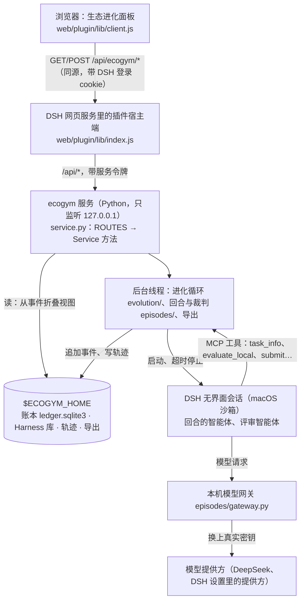

# 架构：前后端怎样配合

ecogym 0.3.5 · 本文说明浏览器里的「生态进化」面板、DSH 里的插件宿主端和 ecogym 服务怎样分工，一次请求经过哪些层，状态放在哪里，以及加接口、加页面时改哪些地方。进化本身的设计见 [evolution.md](evolution.md)；面板的「介绍」页讲项目在做什么，不讲这些分层。

## 1. 分层

| 层 | 文件 | 做什么 | 不做什么 |
|---|---|---|---|
| 面板 | `web/plugin/lib/client.js` | 页面、表单、轮询；用 DSH 的组件和设计令牌 | 不保存运行状态；只在浏览器里记住导航和新建表单的草稿 |
| 插件宿主端 | `web/plugin/lib/index.js` | 随 DSH 启动、看护、停止服务；同源代理；回答 `_status`、`_restart` | 不理解业务接口，只转发 |
| 服务 | `service.py` | 接口表 `ROUTES`；把请求交给 `Service` 的方法；运行进化、验证和导出的线程 | 不在内存里保留可能丢失的状态：视图都从账本现算 |
| 业务代码 | `evolution/`、`episodes/`、`evaluation/`、`harness/`、`task/`、`protocol/`、`data/`、`kernel/` | 进化循环、回合、裁判、比较、Harness 存储、任务与数据、账本 | 不依赖界面；上层只依赖下层（`tests/ecogym/test_layers.py` 检查） |

## 2. 一次请求的路径

1. **浏览器**：`api(path, { body })` 发 `fetch("/api/ecogym/" + path)`，带 DSH 的登录 cookie；POST 加 `X-Ecogym: 1` 和 JSON 请求体。面板用到的全部路径都在 `client.js` 的 `Api` 表里，读用 `useResource(path, { interval })` 轮询（内容没变不重新渲染，页面隐藏时暂停），写用 `api(path, { body })`。
2. **插件宿主端**：先过 DSH 自己的 `connection.requestRejection`（Host 必须是回环或受信主机，跨站请求和不同源的 Origin 被拒，必须已登录）。`_status`（服务状态和最近输出）和 `_restart` 在这里回答；其余去掉 `/ecogym` 前缀转发到 `127.0.0.1:<端口>/api/...`：去掉 Cookie、Origin、Referer，换上随机生成的服务令牌；请求体上限 2 MB，超时 120 秒，浏览器断开时一起断开。服务没就绪返回 503（附服务状态），没有响应返回 502。
3. **服务**：核对令牌；POST 先检查 `X-Ecogym: 1` 和请求体（必须是 JSON 对象，不超过 1 MB）；在 `ROUTES` 里找到路由，调用 `Service.<handler>`：路径里 `{…}` 匹配到的段依次作为参数，需要请求体的再加上请求体，需要的查询参数作为关键字参数。返回 JSON（方法竞技的报告是 HTML）；出错时返回 `{"error": "…"}`，状态码 400（参数不对）、403、404、409（状态冲突，例如运行还没结束）、413 等。
4. **后台工作**：开始进化、继续、验证、导出的请求立即返回（201 或 202），工作在服务的线程里进行，进度写进账本；页面靠轮询看到变化。

## 3. 状态放在哪里

- **账本**（`$ECOGYM_HOME/ledger.sqlite3`）是唯一的事实来源：只追加、带哈希链的事件。进化运行、回合、专家问答、曝光登记都是事件；面板上的每个视图都在请求时从事件折叠出来（`evolution/fold.py`、`episodes/history.py`）。
- **服务内存**只放它正在运行的线程（进化、验证、导出）和缓存：打开过的任务数据（`Bench`）、模型可用性检查（十分钟）。
- **浏览器**只记住当前页面和新建进化表单的草稿（`localStorage`）。
- 所以后端随时可以重启：进化停在最后一个完成的代，记为“已停止”，点「继续运行」从那里接着跑；重启前后看到的数字相同。每一代记下运行它的进程，进程已不在时面板显示“已中断”。

## 4. 页面与接口

| 页面 | 组件 | 读（轮询间隔） | 写 |
|---|---|---|---|
| 顶栏 | `EcogymPanel` | `_status`（4 秒）、`expert`（30 秒，待回答问题的数字）、`catalog`（打开时一次，失败按 2–30 秒退避重试） | `_restart`（后端失败或退出时的按钮） |
| 进化 | `EvolutionList` | `evolutions`（8 秒） | |
| 运行页 | `EvolutionPage`，分四部分（`RUN_SECTIONS`）：概览（正在进行 `LiveCard`、文字结论 `RunSummary`、成绩图 `ScoreCard`、独立验证 `Verification`），每一代（`Process`），版本与成绩（谱系图 `LineageCard`、逐任务成绩 `Scoreboard`、在任 Harness `HarnessCard`），设置（`ConfigCard`） | `evolutions/{run}`（运行中 5 秒，否则 30 秒；含 `ancestry`：起点版本是哪些运行进化出来的）、运行中 `episodes?evolution={run}&generation={当前代}`（8 秒；服务只折叠这一代的回合）、展开在任 Harness 时 `harnesses/{ref}` 和 `harnesses/{起点}/diff/{在任}`；展开一代时 `evolutions/{run}/evolver/{代}?steps=0`（评审看过的材料），候选从存档版本出发时 `harnesses/{出发的版本}/diff/{候选}` | `evolutions/{run}/stop`、`abort`、`resume`、`finish`（就此结束停下的运行）、`verify`（留出、封存时期，或 `kind: adoptions` 复核各次采纳） |
| 评审会话 | `EvolverPage`（`go({ page: "evolver", id: "运行\|代" })`） | `evolutions/{run}/evolver/{代}`（打开时一次） | |
| 新建进化 | `NewEvolution` | `catalog` | `models/check`（选中模型时）、`evolutions` |
| 回合 | `EpisodeList`、`EpisodePage` | `episodes`（8 秒）、`episodes/{id}`（运行中 5 秒）、点「显示每一步」时 `episodes/{id}/transcript` | |
| 专家 | `ExpertPage` | `expert`（15 秒） | `expert/answer`、`expert/note` |
| 训练数据 | `DataPage`、`ExportPreview` | `exports`（20 秒，导出中 3 秒）、`exports/{id}` | `exports` |
| 任务 | `TasksPage` | `catalog` | |
| 介绍 | `AboutPage` | `catalog`、`tasks/{task}/stages` | |

服务的方法竞技接口（`runs`、`runs/{run}`、`/cells`、`/report`、`/stop`、`/seal`）面板不调用，留给直接使用 `ecogym serve` 的程序和测试；命令行不经服务，直接调用方法竞技。完整的接口表是 `service.py` 的 `ROUTES`，`GET /api/routes` 返回同一张表（经 DSH 访问时是 `/api/ecogym/routes`）。

## 5. 代码地图

- `service.py`：`ROUTES`（每条路由的方法、路径、处理方法、分组和说明）在文件开头；`Service` 的方法大致按“目录、进化、回合、Harness、模型、专家、训练数据、方法竞技”排列；`_handler` 只做鉴权、请求体检查和查表。
- `web/plugin/lib/index.js`：`Sidecar`（启动、就绪检测、崩溃后按 2、5、15、30、60 秒退避重启、停止）和 `handle`／`forward`（代理）。
- `web/plugin/lib/client.js`：一个文件（DSH 直接加载，不经构建），依次是样式、数据（`Api` 表、`api`、`useResource`、目录、模型路由）、提示与确认、格式化与状态文字、基础组件（`PageHead`、`Card`、`Table`、`Details`、`hint`、`Link` 等，DSH 有同类组件时用 DSH 的）、后端状态、进化运行、进化过程（谱系图、每一代的过程）、新建进化、回合、会话的每一步与评审会话页、专家、训练数据、任务、介绍、面板（顶栏 `TABS`、导航、在 DSH 里注册）。导航的 `back` 是子页面返回按钮的去处，`focus` 让运行页打开并滚到某一代（从回合或评审会话返回时用）。
- 运行页的文字结论和成绩图只用 `evolutions/{run}` 的数据：在任版本的成绩取它最近一次比较里各任务在任回合的均值，候选的成绩是这个值加上比较的增益，误差范围就是比较的区间；“可信地更好”是区间整段在 0 以上。起点版本的来历由 `evolution/ancestry.py` 从账本里的采纳事件往回追（最多 5 次运行），带上那次比较前后的成绩和最终版本的独立验证。
- 会话的每一步来自 `episodes/transcripts.py`：从模型调用记录重建线程，按训练数据导出的规则处理路径和令牌，过长处保留首尾；面板的回合会话记录和评审读到的 `transcript.md` 用同一份。`evolution/process.py` 从评审会话的步骤里整理出它看过的材料、调用宿主工具的结果和改动候选文件的步骤（命令行改了哪些文件是从命令里推断的）。
- 业务代码的分层见 README 的“代码结构”。

## 6. 加一个接口或页面

- **接口**：在 `Service` 里写方法；在 `ROUTES` 里加一行（方法、路径、处理方法、分组、说明；需要请求体的设 `body=True`，查询参数写进 `query`，返回 HTML 的设 `html=True`）。`GET /api/routes` 会自动列出它。面板要用就在 `client.js` 的 `Api` 表里加对应的路径。
- **页面**：写一个组件；顶栏页面加进 `TABS` 和 `EcogymPanel` 里的分派，某个页面里的子页面用 `go({ page, id })`。
- **生效方式**：以链接方式安装插件时，改了 `client.js` 刷新页面即可；改了 Python 代码要重启后端（重启 DSH，或带 `X-Ecogym: 1` 头 POST `/api/ecogym/_restart`）；改了 `index.js` 要重启 DSH。重启后端不影响已完成的代，正在运行的进化停下后可以继续。
