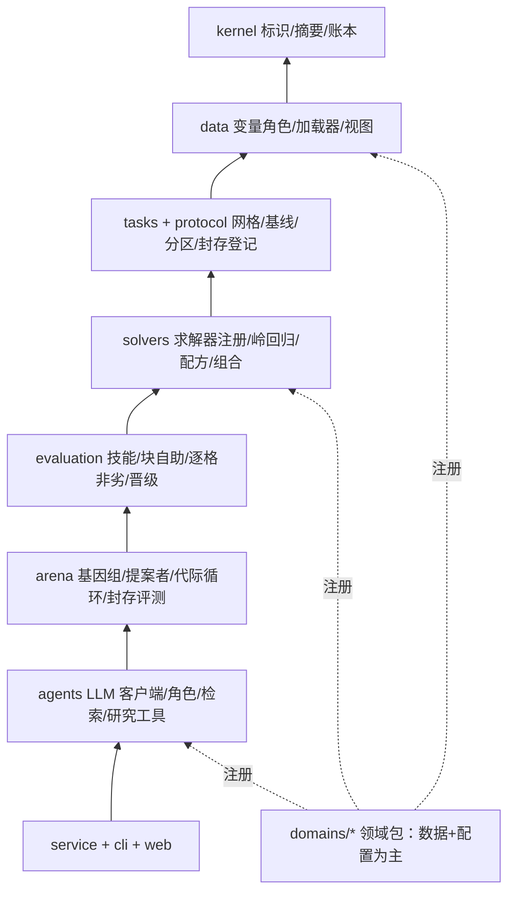

# 重构方案：从温室进化系统到生态学预测训练场

日期：2026-10-28 · 基于 0.10.33 工作树的代码审查 · 状态：已确认并实施为 ecogym 0.1.0，结果与差异见 [实施记录](implementation-2026-10-28.md)

## 1. 结论

建议在同一仓库内新建一个领域无关的核心包（暂名 `ecogym`），把现有系统中经过验证的部分（数据分区、基线、评分、统计门槛、岭回归与特征配方、专家模型、账本、LLM 角色契约）逐块迁入，用“金标准对照测试”保证数值与 0.10.33 一致，达到对等后删除旧包。不建议在旧包上原地重构，原因见第 2.4 节。

预期规模：框架核心约 1.5 万行（现在 11.3 万行），测试 1–1.5 万行（现在 9.3 万行），网页 3–4 千行（现在 1.17 万行）。新增一个生态领域只需添加一个领域包（数据集定义、任务卡、可选的专家模型和知识条目），不改框架代码。

## 2. 现状诊断

### 2.1 规模与分布

| 部分 | 行数 |
|---|---|
| Python 源码 `src/ecologyrsi_dsh` | 113,292 |
| Python 测试（189 个文件） | 92,799 |
| Node DSH 插件 lib ／测试 ／预设与 schema | 7,914 ／ 13,132 ／ 2,644 |
| 网页前端 | 11,716 |
| 脚本 | 6,026 |

15 个超过 2,000 行的文件合计 62,368 行，占源码 55%。最大的几个单元：`EvolutionDirector` 一个类 6,145 行、约 100 个方法（账本命令、LLM 提案调用、晋级统计、用量核算、样本检查点校验都在里面）；`RunStateReducer` 2,979 行；HTTP 处理类 3,650 行；其中 `_bind_runtime_task` 一个函数 1,022 行，实际承担“实验配置编译器”的职责。

### 2.2 结构问题

1. **没有分层。** core、evaluators、evolution、knowledge、integrations、execution、science 七个包互相导入，构成一个强连通分量；core 的 37 个模块中有 12 个导入上层包，多数循环靠函数内延迟导入掩盖。api 包里有调度器和领域规则（选预测器、选评测器、拟合残差面板）。
2. **策略是一袋无类型字符串。** 共有 88 个不同的 `*_policy` 字符串，约 35 个作为运行级 `metadata` 键，在创建时逐个盖章，再在各处用 `metadata.get` 分散判断（例如 effect_contracts 在 15 个文件里被引用）。`name@N` 形式的版本标识超过 250 个。
3. **同一信息登记多次。** 本周新增一个预测器（专家模型）需要改 16–17 个文件：11 个参数名在 8 个文件里重复约 10 次，参数边界 4 份，默认值 3 份，评测器与预测器的兼容关系 5 处。漏掉其中一处（算法 IR 登记）就导致专家种子运行在第 0 代检索阶段暂停，这是今天实际发生的故障。
4. **领域假设写死在通用代码里。** `air_temperature` 出现在 17 个文件的 88 行，`_residual_scale` 232 行，`"greenhouse"` 子串 39 个文件 343 行，字面量 `(1, 6, 24)` 16 个文件 36 行。领域路由靠“名字里是否含 greenhouse”判断。
5. **并行实现。** 两套代际循环、两套代际分析、两种局部评估模式、两套样本智能体栈（gateway 与 DSH-native）同时存在。
6. **兼容负担。** 约 2,000–2,500 行只为回放旧运行或旧协议存在；另有约 9,000–10,000 行属于已被取代但仍可创建的非原生流水线。合计约占源码 10%，还不算大文件内部的版本分支。为了保证冻结摘要不变，新增能力只能“复制一个新版本”（例如为加一个预测器而新建评测器 @6、重建历史注册表快照），这是代码持续膨胀的直接原因。

### 2.3 逐样本 LLM 已不再影响预测

0.10.32 起，样本智能体只能调用候选自身的工具并逐位抄写其输出，宿主以 1e-9 容差校验。预测完全由候选基因组决定，LLM 只影响覆盖率、耗时和费用。但这条链仍占运行时间的大部分：每代冻结预算为 200 次候选时点评估（另有最多 100 次复核），每次都要一次 LLM 抄写调用。2026-10-28 的基线种子运行中，初筛的 50 次时点评估用了 45 分钟；按这个速度一代约 3 小时，三代约 9 小时，而宿主直接计算同样的数值只需数秒。与这条链相关的代码约 7,500 行 Python、500 行 Node，以及约 10,000 行测试。

### 2.4 为什么不原地重构

旧包的大部分体积来自“冻结摘要不能变”这一约束：任何结构调整都会改变已冻结运行的评测器、注册表或种子摘要，于是只能叠加新版本并保留旧路径。原地重构必须继续背着这个约束，删不掉东西。新包从新的账本格式开始，旧运行留在旧版本里查看，才能真正收缩。

## 3. 目标：训练场的含义

“生态学训练场”在这里指一个可复现的竞技环境，供三类“参赛者”在同一规则下比较：

- 基线与专家模型（人写的方法）；
- 自动搜索（参数扫描、随机或贝叶斯搜索）；
- LLM 研究智能体（读任务卡、做数据分析、查文献、提出方法修改）。

训练场负责：定义任务；控制信息集（不能看未来、不能看封存分区）；用统一的统计门槛判定“是否真的更好”；记录完整来源；封存测试每个方法只评一次；给出排行榜。对 LLM 智能体来说，这就是一个“研究能力”的训练与评测环境，回报来自评测协议，诚实的泛化度量来自封存测试。

## 4. 目标架构

### 4.1 核心概念

| 概念 | 内容 | 现有对应 |
|---|---|---|
| 数据集 Dataset | 按时间索引的多变量序列（多个站点或团队）；变量带角色、单位、可得延迟；内容寻址快照 | data/adapters, definitions, greenhouse loader |
| 任务 Task | 目标与权重、时距（以步长计）、时间轴步长、信息集规则（历史长度、可用角色、已知未来协变量）、基线菜单、指标 | DatasetAdapter + 分散在各处的常量 |
| 协议 Protocol | 分区（拟合／校准／选择／验证／最终测试，隔离期按步长和最大时距推导）、队列抽样、统计门槛、封存曝光登记 | splits, epoch_cohorts, noninferiority, promotion, exposure_registry |
| 求解器 Solver | `fit(拟合视图, 任务, 参数)` 与 `predict(拟合结果, 起点批次)`；参数表由任务网格生成；只登记一次 | greenhouse_prediction, feature_recipe, diurnal_profile 等 7 处注册表 |
| 基因组 Genome | 求解器引用 + 参数 + 可选特征配方 + 可选组合程序；确定性地决定预测 | evolution/genome, strategy_program |
| 提案者 Proposer | 产生有界的基因组修改。扫描、随机、贝叶斯、LLM 研究智能体、人工共用一个接口 | strategies.py（只服务 LLM） |
| 竞技循环 Arena | 每代：提案 → 初筛 → 决赛 → 与在任者在留出队列上配对比较 → 晋级；结束后封存评测 | generation_execution, work_units, formal_trajectory |
| 账本 Ledger | 追加写事件，约 12 种事件类型；记录数据、任务、协议、基因组和代码版本的摘要 | core/ledger + state（69 种事件分支） |
| 领域包 DomainPack | 数据集定义、任务卡、角色词表与物理边界、领域基线、专家求解器、机理特征原语、知识条目和提示词 | 散落在通用代码中 |

### 4.2 分层（上层依赖下层，禁止反向导入，用测试强制）

1. `kernel`：标识、规范 JSON 与摘要、错误类型、类型化配置基类、SQLite 账本。
2. `data`：变量与角色、数据集规格、加载器协议、快照、视图（选择视图与封存视图分开发放）。
3. `tasks`、`protocol`：目标网格与统一的格键、基线注册、分区、队列、封存曝光登记。
4. `solvers`：求解器协议与唯一注册表；基线、岭回归、特征配方、组合程序。
5. `evaluation`：逐格技能、配对时间块自助法、逐格非劣、晋级判定。
6. `arena`：基因组与有界变异、提案者协议、代际循环、封存评测流程。
7. `agents`：LLM 客户端协议（OpenAI 兼容 HTTP、DSH 两种传输）、研究员／提案者／评审三个角色、文献检索、研究工具。
8. `service`、`cli`、`web`：薄 HTTP 接口、后台运行、由账本折叠得到的视图、网页工作台。

领域包放在 `ecogym/domains/<name>/`，以后可通过 Python entry point 安装外部领域包。



### 4.3 设计原则

1. **机制写代码，领域写配置。** 通用代码中不出现任何目标名、列名或数据集 ID。
2. **每个概念一个注册点。** 求解器用一个规格对象登记，目录、参数表、摘要、提案契约都从它派生。
3. **策略是类型化配置。** 一个冻结的 `RunConfig` 数据类（日程、门槛、预算、提案者设置），整体带版本号，代替约 35 个独立的 metadata 键。
4. **确定性优先。** 预测由宿主执行基因组得到；LLM 只在方法层工作（提出假设和修改、解释结果），不再逐样本抄数。
5. **复现靠记录，不靠保留旧代码。** 每个运行记录配置、各项摘要和代码版本；续跑要求兼容的代码版本；旧运行导出为静态报告。
6. **信息集由视图强制。** 求解器和智能体研究工具拿到的视图只包含允许的分区与时刻，封存分区只有封存评测流程能打开，且每阶段每个方法一次。

### 4.4 关键接口草图

```python
class Solver(Protocol):
    spec: SolverSpec                       # id、版本、由任务网格生成的参数表、默认值
    def fit(self, view: FitView, task: Task, params: Params) -> Fitted: ...
    def predict(self, fitted: Fitted, batch: OriginBatch) -> Forecasts: ...  # batch 只暴露起点及以前

class Proposer(Protocol):
    def propose(self, ctx: ArenaContext, parent: Genome, k: int) -> list[Edit]: ...
    # 实现：SweepProposer、RandomProposer、LLMResearchProposer、HumanProposer
```

任务卡示例（温室，现有任务）：

```yaml
task_id: greenhouse.agc2018.cucumber.climate@1
dataset: agc_cucumber_2018
time_axis: {step: 1h}
targets:
  - {name: air_temperature, unit: degC, weight: 0.3333, bounds: [-10, 60]}
  - {name: relative_humidity, unit: percent, weight: 0.3333, bounds: [0, 100]}
  - {name: co2_concentration, unit: ppm, weight: 0.3334, bounds: [0, 5000]}
horizons: [1, 6, 24]            # 以步长计
information_set: {history_steps: 48, roles: [environment, outside_weather, action], known_future: []}
baselines: [persistence, seasonal_naive(period=24)]   # 在 calibration_fit 上逐格选择
protocol: time_forward_four_stage@1
gates: {cell_noninferiority_alpha: 0.05, hard_cap: 0.03, min_practical_delta: 0.005, block_steps: 24}
```

同一框架下的日尺度任务（示意）：

```yaml
task_id: soil.site_x.moisture@1
time_axis: {step: 1d}
targets: [{name: soil_moisture_10cm, unit: m3_m3, weight: 1.0, bounds: [0, 0.6]}]
horizons: [1, 3, 7]
information_set: {history_steps: 60, roles: [weather, soil], known_future: [precipitation_forecast]}
baselines: [persistence, climatology(day_of_year)]
```

## 5. 现有能力的去留

| 现有部分 | 处理 |
|---|---|
| 四阶段分区、隔离期、证据下限 | 迁入 `protocol`，改为以步长计 |
| 基线选择、逐格技能、配对块自助、逐格非劣、晋级判定 | 迁入 `evaluation`，规则不变，参数来自任务卡 |
| 岭回归、特征配方、组合程序 | 迁入 `solvers`；配方原语按角色而不是列名工作 |
| 专家模型（昼夜廓线-机理集成） | 迁入温室领域包；机理项的列名改由领域包配置 |
| 账本、事件溯源 | 保留思路，事件类型从 69 种压到约 12 种 |
| 研究／提案／评审角色、结构化输出校验、文献检索 | 迁入 `agents`；DSH 作为传输之一 |
| 封存评测与曝光登记 | 迁入 `arena`，保留“每阶段一次” |
| 逐样本 LLM 链（规划、评审、反思、修复、抄写校验） | 删除；如需研究“LLM 直接预报”，作为一种求解器单独评测 |
| gateway 样本模式、非原生流水线、旧协议与旧评测器 @1–@5 | 删除 |
| Skill 程序、指令模板、指令参数、A/A 复测 | 删除（确定性执行后 A/A 漂移恒为 0） |
| 约 35 个 metadata 策略 | 合并进类型化 `RunConfig` |
| 6,819 行的服务端投影 | 改为账本折叠的通用视图加少量科学事实摘要 |
| 发布与交付脚本 | 保留最小打包，其余移除 |

## 6. 迁移步骤

每一步结束都有可运行的系统和验收清单，可以在任意一步后暂停。

| 阶段 | 内容 | 验收 |
|---|---|---|
| 0 冻结 | 给 0.10.33 打标签；处理两个暂停中的运行；导出全部运行摘要 | 旧版本可单独安装查看 |
| 1 内核与数据 | kernel、data、tasks、protocol；温室加载器 | 黄瓜数据各分区边界与旧系统逐行一致（calibration_fit 576 行等）；基线选择一致 |
| 2 求解器与评测 | 求解器注册；基线、岭回归、配方、专家模型；评分与门槛 | 专家模型 model_selection +0.1292、calibration_uq +0.1769，recipe 种子 +0.0878；逐格 RMSE 与旧系统差 < 1e-9 |
| 3 竞技循环 | 基因组、有界变异、扫描与随机提案者、代际循环、封存流程、CLI | 一条命令在黄瓜任务上跑 3 代扫描，数分钟完成，账本可回放 |
| 4 LLM 智能体 | 客户端接口与两种传输；三个角色；只能访问训练分区的研究工具 | 专家种子 3 代运行，每代 LLM 调用不超过约 10 次，总时长约 1–2 小时 |
| 5 服务与界面 | 薄 HTTP 接口、后台运行、精简网页（运行、代际时间线、逐格技能、排行榜、封存评测） | 浏览器内创建并完成一次运行 |
| 6 第二个领域，移除旧包 | 新领域的数据集、任务卡、基线；“新增领域指南”与领域一致性测试；删除旧包、旧插件、旧前端 | 新领域不改框架代码即可运行 |

迁移期间评分语义保持不变，先对等，后改进。

## 7. 风险与对策

| 风险 | 对策 |
|---|---|
| 遗失旧系统里积累的细节（因果检查、门槛的边界情况） | 金标准对照测试；门槛规则逐条迁移并各配一个测试 |
| DSH harness 版本耦合 | DSH 只作为可选传输，接口保持最小；同时支持 OpenAI 兼容 HTTP |
| 范围蔓延 | 每阶段有固定验收；新功能在对等之后再加 |
| 封存数据被多次查看 | 保留曝光登记；新旧系统合计，每个方法的验证与最终测试各只评一次 |

## 8. 需要确认的决策

1. 新框架不再续跑或回放旧运行，旧运行留在 0.10.33 中查看并导出报告。
2. 取消逐样本 LLM，改为宿主直接执行候选方案；LLM 只在方法层工作。
3. DSH 保留为智能体传输之一，同时支持 OpenAI 兼容 HTTP。
4. 第二个领域选哪个数据集（候选：土壤水分如 ISMN，碳水通量如 FLUXNET/AmeriFlux，物候如 PhenoCam，河流水温或水质如 USGS，或手头已有的数据）。
5. 新包名（暂名 `ecogym`），在本仓库 `src/` 下与旧包并行开发，完成后删除旧包。
6. 界面：先做 CLI 和静态 HTML 报告，阶段 5 再做精简网页；或者一开始就保留网页。

确认结果：1–3、5、6 按建议执行（CLI 与静态报告先行，阶段 5 加精简网页）；第二个领域选 AGC 2019 番茄。
